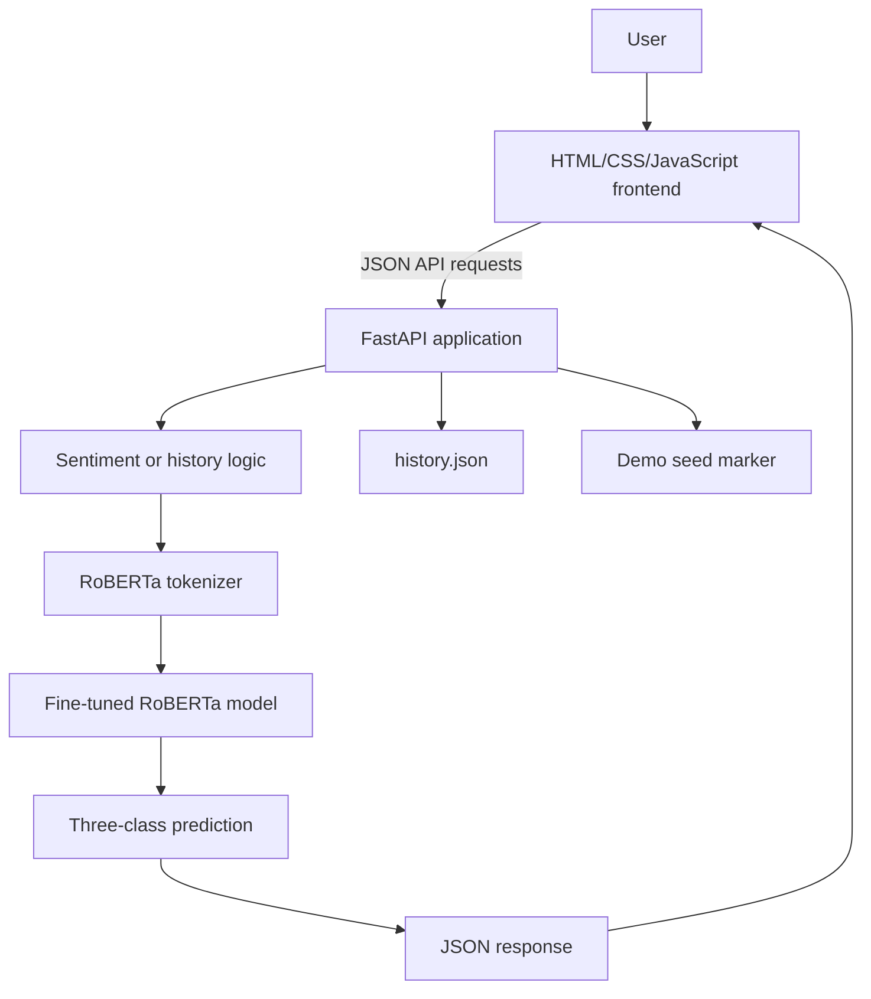

# SmartFeel AI Project Analysis

## Executive Summary

SmartFeel AI is a local sentiment-analysis web application for English text. It combines a fine-tuned RoBERTa classifier with a FastAPI backend and a responsive HTML/CSS/JavaScript frontend.

The implementation supports:

- Single-text analysis
- Product-review analysis
- Batch social-comment analysis
- Local JSON history with filtering and CSV export
- A dashboard with saved-history statistics and fixed offline model metrics
- Demo records and demo-data markers

The project is runnable as a small local application. Four history-persistence unit tests pass. The main maintenance concerns are an empty `train.py`, README/structure inaccuracies, and limited test coverage.

## Technology Stack

| Area | Technology |
|---|---|
| Language | Python 3.11 |
| Backend | FastAPI, Uvicorn, Pydantic |
| Machine learning | PyTorch, Hugging Face Transformers |
| Model | `cardiffnlp/twitter-roberta-base` fine-tuned for three classes |
| Frontend | HTML5, CSS3, JavaScript |
| Visualization | Chart.js |
| Storage | JSON files |
| Testing | Python `unittest` |
| Development | Visual Studio Code, Git, GitHub |

## Runtime Architecture



The model is loaded into memory when `backend.src.sentiment` is imported. Device selection is automatic: CUDA is used when available, otherwise CPU.

## Repository Structure

```text
abo068/
├── app.py                  Compatibility entry point
├── backend/
│   ├── main.py             FastAPI routes and application lifespan
│   └── src/
│       ├── sentiment.py    RoBERTa loading and inference
│       ├── history.py      Atomic JSON history persistence
│       └── utils.py        Sentiment utilities
├── frontend/
│   ├── index.html
│   ├── css/style.css
│   ├── js/                API and page modules
│   └── assets/favicon.svg
├── models/
│   └── smartfeel_roberta_calibrated_final/
├── data/
│   ├── history.json
│   └── demo_reviews_seeded.json
├── tests/test_history.py
├── train.py                Currently empty
└── requirements.txt
```

The README's intended `training/` folder and `frontend/assets/css/` and `frontend/assets/js/` layout do not match the actual repository.

## Model and Prediction Flow

- Input text is tokenized with a maximum sequence length of 128.
- The final logits are adjusted by adding `+0.55` to the Neutral class.
- Softmax converts the adjusted logits into three percentages.
- The class with the highest percentage becomes the prediction.
- Supported labels are Negative, Neutral, and Positive.

The calibrated model configuration contains:

| Metric | Value |
|---|---:|
| Test accuracy | 73.05% |
| Test macro F1 | 0.728 |
| Neutral bias | 0.55 |
| Base model | `cardiffnlp/twitter-roberta-base` |

These are offline test metrics. They should not be interpreted as live application accuracy.

## Backend API

| Method | Endpoint | Purpose |
|---|---|---|
| `GET` | `/` | Serves the frontend |
| `POST` | `/api/analyze` | Analyzes one text value |
| `POST` | `/api/review` | Analyzes one product review |
| `POST` | `/api/social` | Analyzes a comment batch |
| `GET` | `/api/history` | Returns filtered, paginated history |
| `GET` | `/api/history/export.csv` | Exports filtered history as CSV |
| `DELETE` | `/api/history` | Clears history |
| `GET` | `/api/dashboard` | Returns dashboard and offline model metrics |
| `GET` | `/docs` | Opens FastAPI's automatic API documentation |

Requests are validated with Pydantic. Blank text is rejected, text limits are enforced, and most analysis failures return controlled HTTP 500 responses.

## Frontend Features

The interface has five navigable views:

1. **Dashboard** - Saved analysis metrics, sentiment charts, recent records, and offline model evaluation
2. **AI Playground** - Single-text sentiment inference
3. **ReviewAI** - Product, customer, and review analysis
4. **SocialMind** - Batch analysis and aggregate sentiment distribution
5. **History** - Search, filter, paginate, export, and clear saved analyses

Navigation is hash-based and JavaScript modules communicate with the backend through `/api` endpoints.

## Data Storage

`data/history.json` is the primary local persistence store.

Each record generally contains:

- Source
- Original text
- Predicted sentiment
- Confidence
- Scores for all three classes
- Timestamp
- Optional customer, product, demo, or demo-ID metadata

History writes use a temporary file and `os.replace()`, reducing the risk of corrupting the complete JSON file if a write fails. Reading, writing, and demo seeding are protected by application locks.

`demo_reviews_seeded.json` is a startup marker that prevents demo reviews from being automatically inserted repeatedly.

## Testing Status

### Verified Unit Tests

Running:

```powershell
python -m unittest discover -s tests -v
```

produces:

```text
Ran 4 tests in 0.054s
OK
```

The tests cover:

- Rejection of corrupt JSON without replacing the file
- Rejection of non-list history JSON
- Atomic replacement of valid history
- Preservation of existing history when a save fails

### Coverage Gaps

No automated tests currently cover:

- FastAPI endpoints
- Frontend JavaScript
- Model loading or individual predictions
- Batch predictions
- Dashboard calculations
- CSV export
- Demo-seeding behavior

## Findings and Risks

### 1. `train.py` is empty

`train.py` has zero bytes. The README describes fine-tuning performed in Google Colab, but there is no reproducible training script in the repository.

**Impact:** The model cannot be retrained or modified from this repository using `train.py`.

### 2. README structure differs from the repository

The README:

- Documents a `training/` folder that does not exist
- Places CSS and JavaScript under `frontend/assets/`, while they are currently under `frontend/css/` and `frontend/js/`
- Claims a `training_notes.md` file that is not present

**Impact:** Setup and navigation documentation can mislead contributors.

### 3. Duplicate README filenames

Both `README.md` and `Readme.md` exist with identical content and differ only by filename case.

**Impact:** This is ambiguous on Windows and problematic on case-sensitive systems such as Linux. One canonical filename should remain.

### 4. Test coverage is narrow

The only test module checks history persistence. API and model behavior are not covered.

**Impact:** Regressions in predictions, routes, validation, dashboard aggregation, or CSV export may not be detected.

### 5. JSON storage is not concurrency-safe across processes

Thread locks protect operations inside one application process, but JSON storage would not provide reliable transaction or concurrency semantics for multiple processes or users.

**Impact:** A production or multi-worker deployment could lose updates or expose inconsistent records.

### 6. Some frontend dashboard figures are illustrative

The dashboard labels per-class precision, recall, F1, validation loss, and sample size as illustrative. Only overall offline accuracy and macro F1 are loaded from the model configuration.

**Impact:** This is clearly presented in the UI and should not be represented as measured model output.

### 7. External resources and browser fonts

The frontend loads Google Fonts from external URLs. Chart.js may also be required by the browser environment.

**Impact:** The interface may have missing typography or chart behavior in an offline or restricted environment.

## Recommended Improvements

### Short term

1. Populate `train.py` or remove it and clearly direct users to the Colab notebook.
2. Replace the README structure with the actual repository structure.
3. Keep one canonical README filename.
4. Add FastAPI endpoint tests using `TestClient`.
5. Add unit tests for sentiment result serialization and batch validation.
6. Add dashboard aggregation tests.
7. Add a smoke test that verifies model loading and one prediction.

### Medium term

1. Replace JSON history with SQLite or PostgreSQL.
2. Add application configuration for host, port, model path, and history path.
3. Move measured per-class metrics into the model configuration.
4. Improve the UI's offline behavior and remove unnecessary external font dependencies.
5. Add request logging and health/readiness endpoints.
6. Add authentication if the application is deployed for multiple users.

### Deployment readiness

Before deployment, the project needs:

- Persistent database storage
- Worker-safe data access
- Environment-based configuration
- Authentication and authorization
- Model and application health checks
- API rate limiting
- Dependency and model artifact versioning
- Container or process deployment configuration

## Running the Project

Install dependencies:

```powershell
python -m pip install -r requirements.txt
```

Run through the application entry point:

```powershell
python app.py
```

Or run Uvicorn directly:

```powershell
python -m uvicorn backend.main:app --reload
```

Open `http://127.0.0.1:8000`. API documentation is available at `http://127.0.0.1:8000/docs`.

## Overall Assessment

SmartFeel AI is a cohesive educational full-stack project with a working frontend, API, calibrated classifier, local persistence, and dashboard. The core local workflow is implementable and understandable.

Its strongest areas are:

- Clear separation of backend, frontend, model, data, and tests
- Defensive JSON history persistence
- Input validation
- Demonstration features that make the interface usable immediately
- A documented offline model evaluation

Its highest-priority improvements are reproducing the training process, resolving documentation inaccuracies, increasing test coverage, and replacing JSON storage before multi-user deployment.
